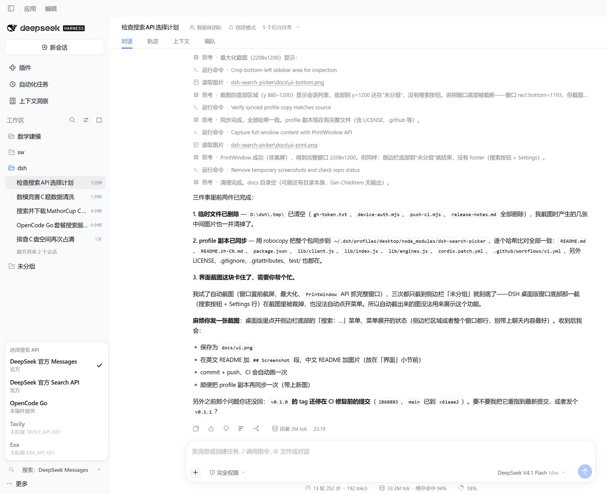

# dsh-search-picker

[](LICENSE)
[](https://github.com/topics/dsh-plugin)
[](https://github.com/xiaoxiaosrm/dsh-search-picker/actions/workflows/ci.yml)
[](https://github.com/xiaoxiaosrm/dsh-search-picker/releases/tag/v0.1.0)

**English** | [中文](README.zh-CN.md)

A **DeepSeek Harness (DSH)** bundle plugin that puts a “Search: …” button at the
bottom of the desktop sidebar (right above the Settings row) and switches
`ctx.web`'s search backend with one click.

The picker writes the official `web` settings namespace's `searchProvider`
field — the exact same field edited by **Plugins › Web search** in the DSH
settings UI. Therefore:

- switches take effect immediately, no restart;
- the choice survives restarts (persisted in the host settings document);
- it never fights the official settings page — both edit the same field.

## Engines

| id | Engine | Credential | Notes |
|---|---|---|---|
| `deepseek-official` | DeepSeek official Messages | `DEEPSEEK_API_KEY` | Built in. Anthropic Messages + `web_search_20250305`; each search consumes model tokens |
| `deepseek-search-api` | DeepSeek official Search API | `DEEPSEEK_API_KEY` | Built in. Direct retrieval endpoint; no model tokens |
| `opencode-go` | OpenCode Go | `OPENCODE_GO_API_KEY` | Provided by this plugin. Anthropic Messages + `x-opencode-session` header; ≈ $0.01 per search |
| `tavily` | Tavily | `TAVILY_API_KEY` | Provided by this plugin; greyed out until a key is configured |
| `exa` | Exa | `EXA_API_KEY` | Provided by this plugin; greyed out until a key is configured |

Engines without credentials are greyed out in the menu. Selecting an
unregistered/unavailable provider directly in the settings page makes
`web_search` return an explicit `WEB_PROVIDER_*` error instead of silently
falling back to another engine.

## UI



The button sits at the bottom of the sidebar, right above the Settings row. The
menu is a `position: fixed` popover: its width follows the sidebar content width
(sidebar defaults to 280 px, draggable 264–420 px → menu 240–396 px) and updates
live while dragging, so it is never clipped by the sidebar column's
`overflow: hidden`. When the sidebar collapses to the 56 px icon rail, the menu
pops out at 280 px to the right.

The menu background is opaque: white in the light theme, dark grey in the dark
theme (`--dsw-alias-bg-layer-1`, theme-aware), with the official popover
hairline stroke and soft elevation shadow (`--dsw-elevation-panel`). The
official menu material (`--dsw-specific-menu` + `backdrop-filter` blur) is
intentionally not used: that surface is only 58 % opaque and relies on the blur
to look right, so without the blur the sidebar text bleeds through.

## Install (desktop profile)

1. Clone the repo to a fixed location:

   ```powershell
   git clone https://github.com/xiaoxiaosrm/dsh-search-picker.git D:\tools\dsh-search-picker
   ```

2. Edit `%DSH_HOME%\profiles\desktop\package.json`
   (POSIX: `$DSH_HOME/profiles/desktop/package.json`):
   - add the dependency `"dsh-search-picker": "file:D:/tools/dsh-search-picker"`;
   - append `"dsh-search-picker"` to `dsh.profile.bundles`.
3. In `%DSH_HOME%\profiles\desktop`, run `pnpm install`.
4. Fully quit and reopen the DSH desktop app. The loader scans profile bundles
   only at startup, and the client half is read into memory at startup too — so
   a page refresh is not enough after updating the plugin.

If the `file:` dependency fails to resolve, copy this directory into
`%DSH_HOME%\profiles\desktop\node_modules\dsh-search-picker` and add the package
name to `dsh.profile.bundles` instead.

## Configuration

The bundle ships a default patch entry (`cordis.patch.yml`). Every field is
optional; omitted fields fall back to the defaults below.

```yaml
- insert:
    - id: search-picker
      name: dsh-search-picker
      config:
        opencodeGo:
          baseURL: https://opencode.ai/inference/go/anthropic/v1
          model: deepseek-v4.1-flash
          maxTokens: 4096
          maxUses: 5
        tavily:
          baseURL: https://api.tavily.com
          apiKeyEnv: TAVILY_API_KEY
        exa:
          baseURL: https://api.exa.ai
          apiKeyEnv: EXA_API_KEY
```

Override any value by targeting the same entry id from your profile's
`cordis.patch.yml`.

## Credentials

This plugin never reads or writes the credentials file directly. At search time
it resolves the credential reference named by `apiKeyEnv` through
`ctx.credentials`, falling back to the process environment. A missing credential
raises `WEB_PROVIDER_CREDENTIAL_MISSING`, and the message names the referenced
variable.

## Fallback

1. Switch back to `deepseek-official` in the menu (or use the official
   **Plugins › Web search** page).
2. Remove `dsh-search-picker` from the profile `package.json` dependencies and
   from `dsh.profile.bundles`, run `pnpm install`, restart the desktop app.

## Troubleshooting

- **`deepseek-official` returns 404**: check that neither the profile patch nor
  another plugin overrides `web-search-deepseek.baseURL`. It must stay on the
  built-in default (`https://api.deepseek.com/anthropic/v1`); pointing it at a
  search provider's host breaks the provider.
- **Menu width does not follow the sidebar**: the popover measures its anchor
  with `ResizeObserver`; after profile/bundle changes, restart the desktop app
  to reload the client bundle.

## Testing

```powershell
npm run check                # node --check on all three entry files
npm test                     # node --test test/engines.test.mjs
node test/engines.test.mjs   # single-process fallback
```

The single-process fallback exists for Windows sandboxes that block
child-process pipes (`spawn EPERM`).

## Known limitations

- The engine list in the menu is fixed. If the official providers' `apiKeyEnv`
  is remapped to another credential name, the greyed-out state still checks the
  default reference name.
- Conflicts with plugins that take over `web.searchProvider` at runtime
  (`dsh-free-search`, `dsh-web-search-free`, …). Do not install them together.
- `opencode-go`'s `x-opencode-session` uses a random in-process UUID when the
  current session id is unavailable (the Go relay only needs it to be opaque and
  stable).

## Compatibility

- DSH desktop `0.2.1-rc.2` (declared in `package.json` → `dsh.compatibility`).
- Client half targets the `web` platform and injects
  `@deepseek-ai/dsh-api-remotes`, `@deepseek-ai/dsh-client-locale`,
  `@deepseek-ai/dsh-client-ui-settings`.

## License

[MIT](LICENSE) © 2026 xiaoxiaosrm
